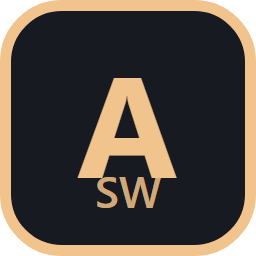

# A StoryWealth Installer

A free, open-source Windows installer for the A StoryWealth Fallout 4 collection on Nexus Mods and its add-ons. It sets them up in a portable Mod Organizer 2 instance, downloads the mods from Nexus, and keeps them up to date.

- Sets up Mod Organizer 2 with Root Builder, F4SE and your tools, and sorts the mods into groups. There's an empty "Added mods" section on top for your own.
- Makes its own copy of the game, so your Steam install isn't touched. A next-gen copy is downgraded with the collection's Downgrader.
- Installs add-ons on top, each in its own section.
- Optional tab for optional mods and groups. Sim Settlements 2 is on by default, HD textures off. Options that need an add-on you don't have are greyed out.
- Premium accounts download automatically. Free accounts download in the browser, one mod at a time, and the installer picks the file up.
- Uses your Vortex downloads first if you point it at them.
- Updates itself from GitHub releases.

## Getting started

1. Download the zip from the [latest release](https://github.com/npc18-projects/aSW-Installer/releases/latest), unzip it anywhere and run `AStoryWealth.Installer.exe`. Windows may warn about an unrecognised app, because the exe isn't code-signed. Click "More info", then "Run anyway".
2. Press **Sign in to Nexus**. Your browser opens on Nexus, you allow the app, and you're back. The sign-in is stored encrypted on your PC and only sent to Nexus. You can take access away any time on Nexus.
3. Pick your folders and install. You need about 150 GB free.
4. In Mod Organizer 2, choose **F4SE** in the drop-down at the top right and press Run. The game only starts through F4SE.

If something goes wrong, send the `install-*.log` file from your install folder.

Not tested yet: a downgrade of a real next-gen game, the HD textures group, and free-account downloads against live Nexus.

Built by Npc18 with AI assistance (Claude).

[Changelog](CHANGELOG.md) · [Roadmap](docs/roadmap.md) · [Third-party licences](THIRD-PARTY-NOTICES.md)
